# WakaSafe

**Application citoyenne de prévention et de sécurité routière au Cameroun**, portée par l'**Association GOSAFE**.

> Statut : **phase 3 — signalements et carte** (formulaire de signalement avec position GPS et photo, carte publique filtrable, validation et infirmation par la communauté, signalements suspects, limites d'actions). Les phases 0 (cadrage et architecture), 1 (fondations de l'app client) et 2 (comptes et profils) sont terminées.
> Avancement détaillé : [ROADMAP.md](ROADMAP.md).

## Sommaire

1. [Présentation et objectifs](#1-présentation-et-objectifs)
2. [Périmètre du MVP](#2-périmètre-du-mvp)
3. [Profils et droits](#3-profils-et-droits)
4. [Stack technique et justification](#4-stack-technique-et-justification)
5. [Architecture et diagrammes](#5-architecture-et-diagrammes)
6. [Structure des dossiers](#6-structure-des-dossiers)
7. [Modèle de données](#7-modèle-de-données)
8. [Roadmap](#8-roadmap)
9. [Workflow Git](#9-workflow-git)
10. [Application client (apps/mobile)](#10-application-client-appsmobile)
11. [Back-office (apps/admin)](#11-back-office-appsadmin)
12. [Tests et qualité](#12-tests-et-qualité)
13. [Déploiement de la démo](#13-déploiement-de-la-démo)
14. [Décisions d'architecture (ADR)](#14-décisions-darchitecture-adr)
15. [Hypothèses et points ouverts](#15-hypothèses-et-points-ouverts)
16. [Contribuer](#16-contribuer)
17. [Propriété et licence](#17-propriété-et-licence)

---

## 1. Présentation et objectifs

WakaSafe vise à réduire les accidents de la route et à sauver des vies au Cameroun. Le MVP doit permettre de :

- **signaler un danger routier en quelques secondes, même sans réseau** ;
- **partager son trajet** avec un proche alerté en cas d'anomalie _(module optionnel, à arbitrer)_ ;
- **s'éduquer** par des quiz, avec des points et des classements ;
- **évaluer** les conducteurs et les agences de voyage ;
- donner à **GOSAFE et aux autorités** une vue d'ensemble : carte, statistiques, modération.

**Phase pilote** : Android d'abord, à Yaoundé, Douala et Bafoussam.

**Priorité actuelle** : une architecture claire et documentée, puis une interface qui donne au client un aperçu fidèle du produit. Les données sont **simulées (mock)** jusqu'au branchement du backend réel (phase 12).

Le produit est composé de **deux applications web** :

| Application                    | Technologie                       | Cibles                                        | Utilisateurs                              |
| ------------------------------ | --------------------------------- | --------------------------------------------- | ----------------------------------------- |
| **Client** (`apps/mobile`)     | React Native + Expo + Expo Router | **Web (URL)** et **Android 8+**, un seul code | Citoyen, Conducteur d'agence, Autorité    |
| **Back-office** (`apps/admin`) | Next.js (App Router)              | Web (desktop d'abord, tablette)               | Administrateur, Autorité (vue simplifiée) |

## 2. Périmètre du MVP

Référence : cahier des charges **DEV-WS-MVP-2026-001** (document confidentiel, non versionné, voir [docs/source](docs/source/README.md)).

| Module                            | Contenu                                                                                                                                                              | Application            | Statut                          |
| --------------------------------- | -------------------------------------------------------------------------------------------------------------------------------------------------------------------- | ---------------------- | ------------------------------- |
| **M1** Comptes et profils         | Inscription, connexion, réinitialisation, profils Citoyen / Conducteur / Autorité, justificatifs, contacts de sécurité (F1.1–F1.5)                                   | Client                 | Inclus                          |
| **M2** Signalements               | 10 catégories, gravité, personnes concernées, photo, GPS, carte publique filtrable, validation communautaire, modération des suspects, limites d'actions (F2.1–F2.6) | Client                 | Inclus                          |
| **M3** Mode hors ligne            | Enregistrement local, icône « hors ligne », synchronisation avec confirmation (F3.1–F3.2)                                                                            | Client                 | Inclus                          |
| **M5** Quiz, points, classements  | QCM avec correction, 5 questions par jour, points traçables, classements mensuel et annuel (F5.1–F5.5)                                                               | Client                 | Inclus                          |
| **M6** Évaluation des conducteurs | 4 critères, moyennes, classements conducteurs et agences, anti-abus, statistiques (F6.1–F6.4)                                                                        | Client                 | Inclus                          |
| **M7** Notifications              | Danger à proximité, rappels de quiz, infos des autorités, mode visuel (F7.1–F7.3). Centre in-app et toasts, FCM plus tard                                            | Client                 | Inclus                          |
| **M9** Back-office                | Connexion, validation des profils, modération, quiz, KPI et heatmap, export CSV, vue Autorité (F9.1–F9.7)                                                            | Admin (Next.js)        | Inclus                          |
| **M4** Partage de trajet          | Contact de sécurité, lien de suivi web, alertes, bouton danger, expiration (F4.1–F4.5)                                                                               | Client + page publique | **Optionnel, sur confirmation** |
| **M8** Mode conduite simplifié    | Grandes icônes, signalement en un appui, annonces vocales (F8.1–F8.3)                                                                                                | Client                 | **Optionnel, sur confirmation** |

**Hors MVP (ne sera pas développé dans cette version)** : défis et challenges, SafeFlash, paiement Mobile Money et récompenses monétaires, sponsors, commandes vocales et gestuelles, iOS, interface Autorité avancée, modération par IA, trophées et événements, API publique.

Les écarts entre le cahier des charges et ce cadrage sont analysés dans [docs/architecture/spec-gap-analysis.md](docs/architecture/spec-gap-analysis.md).

## 3. Profils et droits

| Profil                  | Droits                                                                                                                                                              | Validation du compte                                               | Application                              |
| ----------------------- | ------------------------------------------------------------------------------------------------------------------------------------------------------------------- | ------------------------------------------------------------------ | ---------------------------------------- |
| **Citoyen**             | Signaler, valider ou infirmer, consulter la carte, répondre aux quiz, évaluer un conducteur, consulter son score et les classements, gérer ses contacts de sécurité | Automatique à l'inscription                                        | Client                                   |
| **Conducteur d'agence** | Droits du Citoyen + être évalué et consulter ses statistiques                                                                                                       | Manuelle par un administrateur (identité, permis, agence affiliée) | Client                                   |
| **Autorité**            | Droits du Citoyen + carte, heatmap, alertes critiques, marquer « pris en charge »                                                                                   | Manuelle par un administrateur (justificatif de fonction)          | Client + Admin (vue Autorité uniquement) |
| **Administrateur**      | Validation des profils, modération, gestion des quiz, tableau de bord, export                                                                                       | Compte créé par le prestataire                                     | Admin                                    |

Pendant la validation, un Conducteur ou une Autorité **garde les droits Citoyen**. En cas de refus, il reste Citoyen ([ADR-0009](docs/adr/0009-profile-requests-and-authority-access.md)).

## 4. Stack technique et justification

| Couche                   | Choix                                                                                                  | Pourquoi                                                                                                                       |
| ------------------------ | ------------------------------------------------------------------------------------------------------ | ------------------------------------------------------------------------------------------------------------------------------ |
| Monorepo                 | **npm workspaces**                                                                                     | Aucun outil en plus, compatible Metro, Next.js et Vercel ([ADR-0002](docs/adr/0002-monorepo-npm-workspaces.md))                |
| App client               | **Expo (SDK 58) + React Native + TypeScript strict + Expo Router**                                     | Un seul code pour le web (démo) et Android, prévu par le cahier des charges ([ADR-0003](docs/adr/0003-client-app-stack.md))    |
| Back-office              | **Next.js App Router + TypeScript strict + Tailwind CSS**, TanStack Table, Recharts, Leaflet + heatmap | Imposé par le cahier des charges. Adapté aux tableaux et graphiques sur desktop ([ADR-0004](docs/adr/0004-admin-app-stack.md)) |
| Domaine partagé          | **TypeScript + Zod**                                                                                   | Mêmes types et mêmes règles métier dans les deux apps et dans le futur backend                                                 |
| Données                  | **Interfaces de dépôts + implémentations mock**                                                        | Brancher l'API ou Supabase ne touche qu'une couche ([ADR-0005](docs/adr/0005-data-access-abstraction.md))                      |
| État                     | **TanStack Query + Zustand**                                                                           | Cache, nouvelles tentatives, tolérance au réseau faible, état local léger                                                      |
| Cartographie             | **OpenStreetMap** : Leaflet (web), MapLibre (Android), derrière `AppMap`                               | Gratuit, sans clé API ([ADR-0006](docs/adr/0006-maps-openstreetmap.md))                                                        |
| Notifications            | **Centre in-app + toasts**, interface `NotificationService` prête pour FCM                             | Démo complète sans compte Firebase ([ADR-0007](docs/adr/0007-notifications-in-app-first.md))                                   |
| Qualité                  | ESLint, Prettier, `tsc --noEmit`, Jest + Testing Library, GitHub Actions                               | Contrôles automatiques sur chaque PR                                                                                           |
| Démo                     | **Vercel**, deux projets, prévisualisation par PR                                                      | ([ADR-0008](docs/adr/0008-demo-hosting-vercel.md))                                                                             |
| Cible backend (phase 12) | API REST Node.js + TypeScript, PostgreSQL/PostGIS **ou** MySQL **ou** Supabase, stockage S3, FCM       | Choix de la base **non tranché**                                                                                               |

## 5. Architecture et diagrammes

Les diagrammes sont en Mermaid. Leur source de vérité est [docs/diagrams/](docs/diagrams/README.md). Les copies ci-dessous sont maintenues identiques.

### 5.1 Architecture globale

<!-- diagram:docs/diagrams/02-architecture.md#1 -->

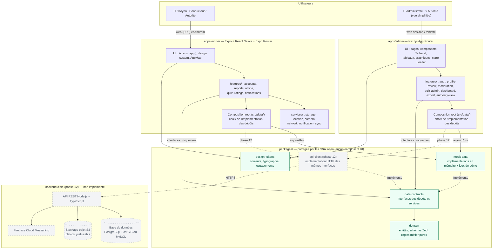

<!-- /diagram -->

**Règle d'or** : les écrans et les features ne connaissent que les **interfaces** de `@wakasafe/data-contracts`. Seule la _composition root_ (`src/data/`) de chaque app choisit l'implémentation : mock aujourd'hui, API demain.

### 5.2 Cas d'utilisation

<!-- diagram:docs/diagrams/01-use-cases.md#1 -->

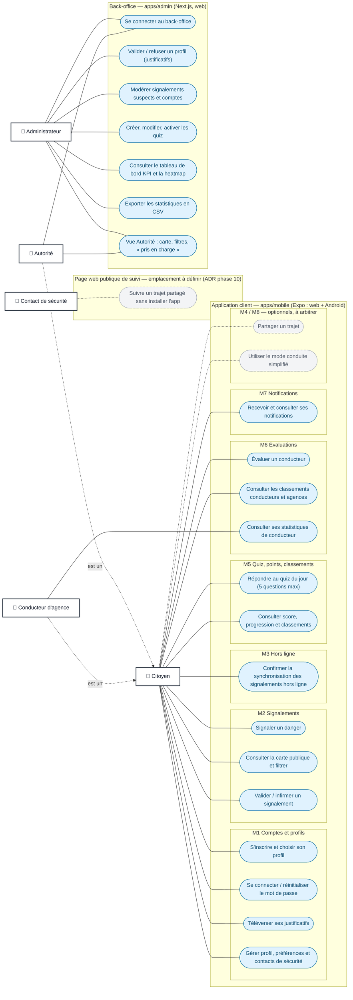

<!-- /diagram -->

Version UML stricte (PlantUML) : [01-use-cases.puml](docs/diagrams/01-use-cases.puml).

### 5.3 Modules et composants

<!-- diagram:docs/diagrams/03-components.md#1 -->

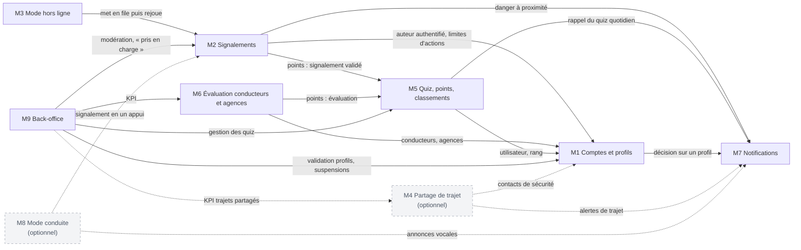

<!-- /diagram -->

<details>
<summary><strong>Composants logiciels par application</strong></summary>

<!-- diagram:docs/diagrams/03-components.md#2 -->

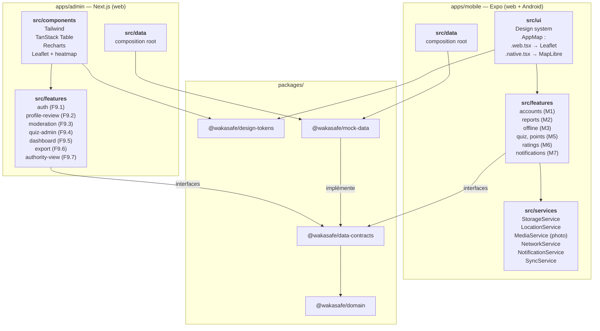

<!-- /diagram -->

</details>

### 5.4 Classes du domaine

<details>
<summary><strong>Diagramme de classes</strong></summary>

<!-- diagram:docs/diagrams/04-domain-classes.md#1 -->

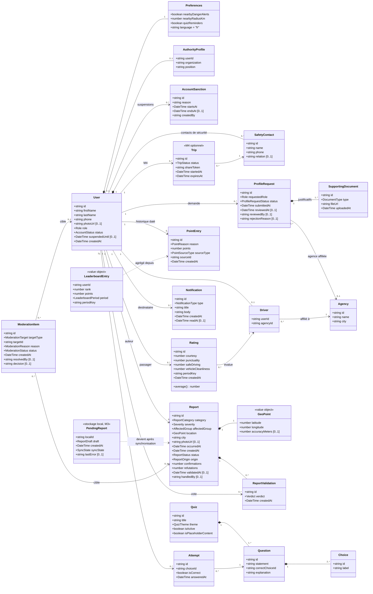

<!-- /diagram -->

</details>

Les énumérations (rôles, statuts, catégories, gravités, motifs de points, types de notifications…) sont listées dans un [tableau dédié](docs/diagrams/04-domain-classes.md#énumérations).

### 5.5 Diagrammes de séquence

<details>
<summary><strong>5.5.1 Inscription et demande de profil Conducteur</strong></summary>

<!-- diagram:docs/diagrams/05-sequences.md#1 -->

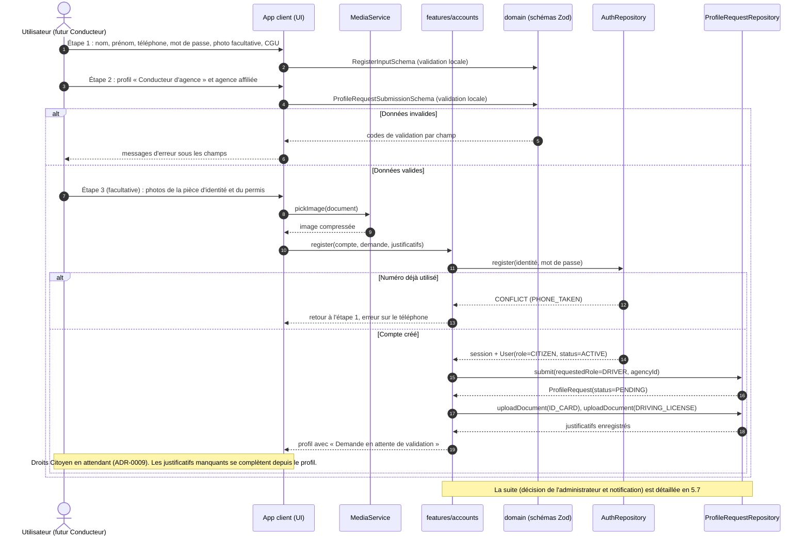

<!-- /diagram -->

</details>

<details>
<summary><strong>5.5.2 Création d'un signalement en ligne</strong></summary>

<!-- diagram:docs/diagrams/05-sequences.md#2 -->

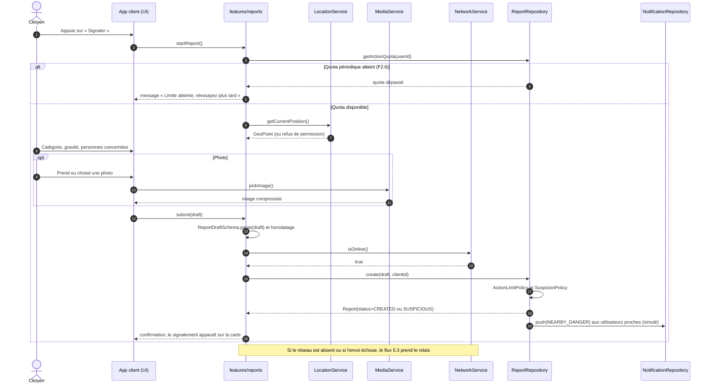

<!-- /diagram -->

</details>

<details>
<summary><strong>5.5.3 Signalement hors ligne puis synchronisation avec confirmation</strong></summary>

<!-- diagram:docs/diagrams/05-sequences.md#3 -->

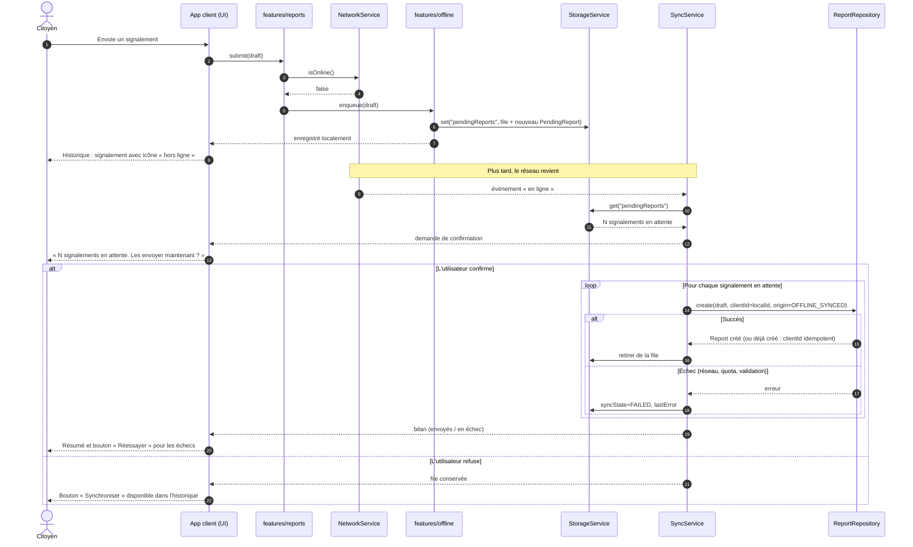

<!-- /diagram -->

</details>

<details>
<summary><strong>5.5.4 Validation communautaire et passage en modération</strong></summary>

<!-- diagram:docs/diagrams/05-sequences.md#4 -->

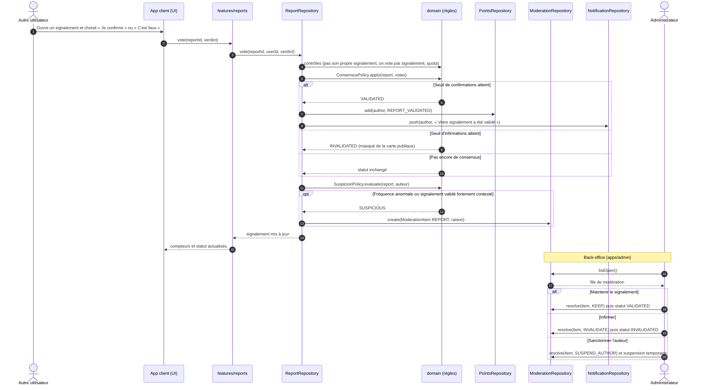

<!-- /diagram -->

</details>

<details>
<summary><strong>5.5.5 Passage d'un quiz et attribution de points</strong></summary>

<!-- diagram:docs/diagrams/05-sequences.md#5 -->

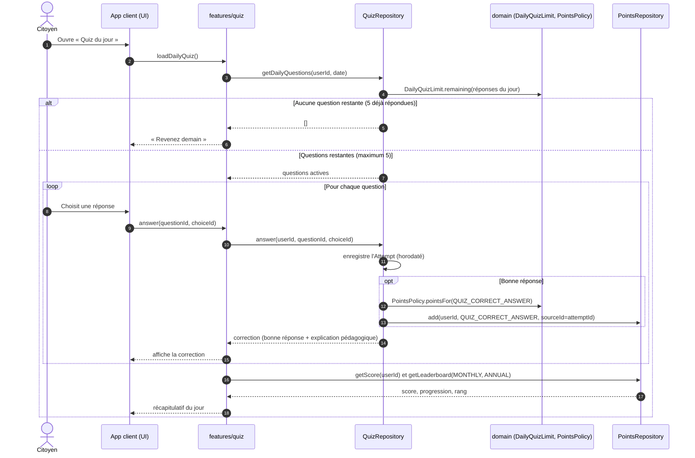

<!-- /diagram -->

</details>

<details>
<summary><strong>5.5.6 Évaluation d'un conducteur avec contrôle anti-abus</strong></summary>

<!-- diagram:docs/diagrams/05-sequences.md#6 -->

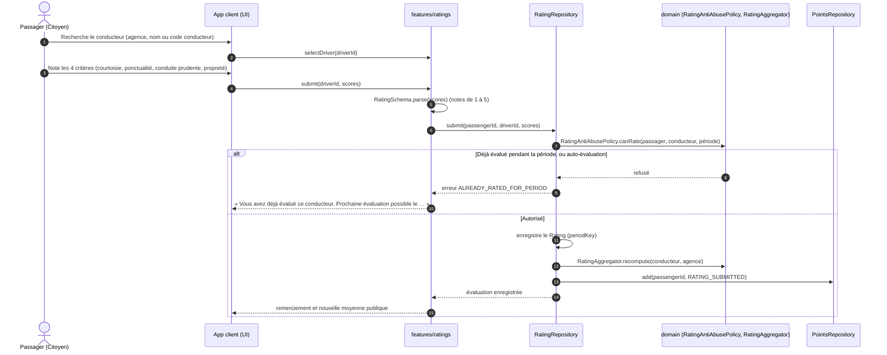

<!-- /diagram -->

</details>

<details>
<summary><strong>5.5.7 L'administrateur valide un profil Conducteur et l'utilisateur est notifié</strong></summary>

<!-- diagram:docs/diagrams/05-sequences.md#7 -->

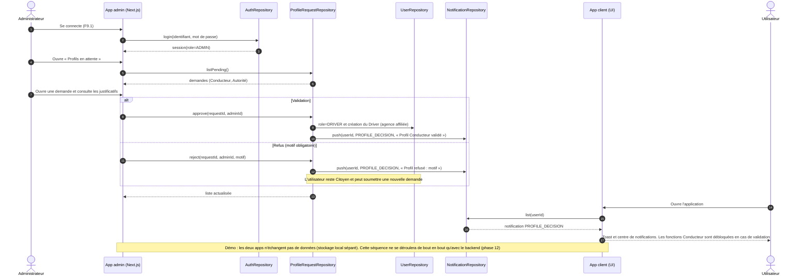

<!-- /diagram -->

</details>

### 5.6 Diagrammes d'états

<details>
<summary><strong>Compte et demande de profil</strong></summary>

<!-- diagram:docs/diagrams/06-states.md#1 -->

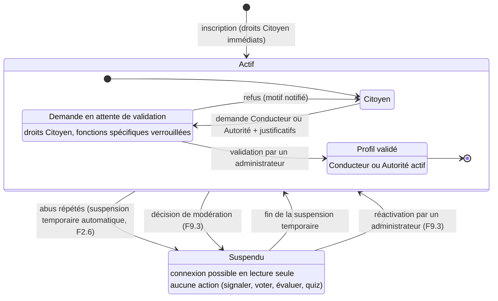

<!-- /diagram -->

</details>

<details>
<summary><strong>Signalement</strong></summary>

<!-- diagram:docs/diagrams/06-states.md#2 -->

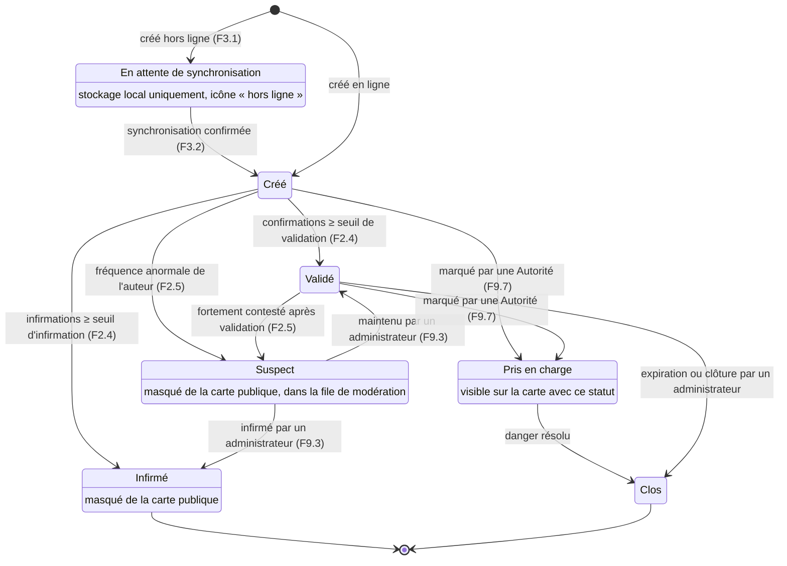

<!-- /diagram -->

</details>

### 5.7 Diagramme d'activité : « Signaler un danger »

<details>
<summary><strong>Flux en ligne et hors ligne</strong></summary>

<!-- diagram:docs/diagrams/07-activity-report.md#1 -->

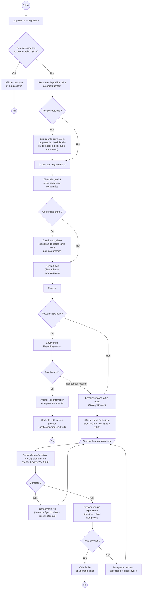

<!-- /diagram -->

</details>

### 5.8 Déploiement

<!-- diagram:docs/diagrams/09-deployment.md#1 -->

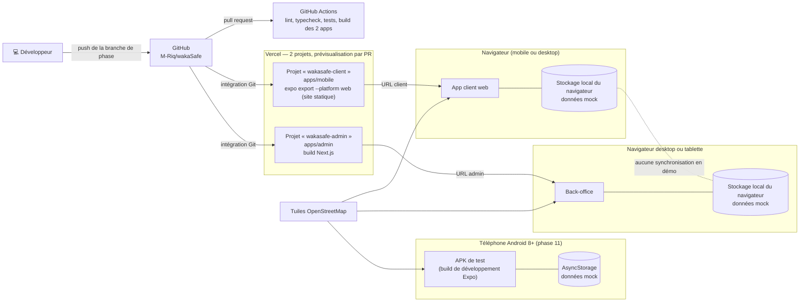

<!-- /diagram -->

<details>
<summary><strong>Cible finale (phase 12 et suivantes)</strong></summary>

<!-- diagram:docs/diagrams/09-deployment.md#2 -->

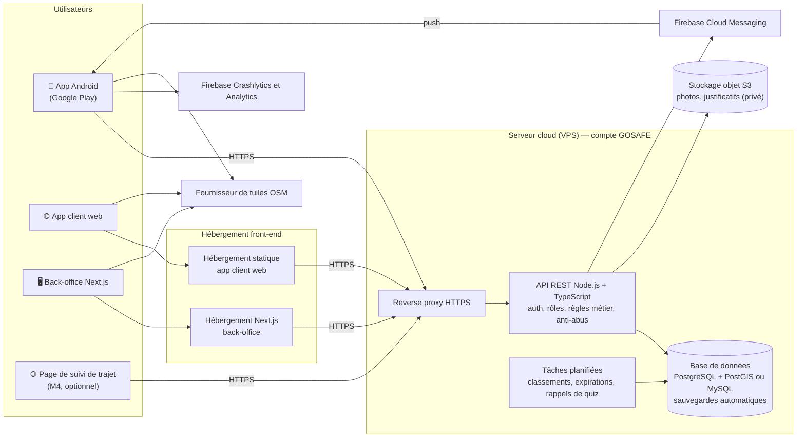

<!-- /diagram -->

</details>

## 6. Structure des dossiers

```text
wakasafe/
├── .github/            # CI, instructions Copilot, modèles d'issues et de PR
├── docs/
│   ├── adr/            # décisions d'architecture
│   ├── architecture/   # structure, règles métier, traçabilité, écarts
│   ├── diagrams/       # diagrammes Mermaid (source de vérité)
│   └── source/         # cahier des charges — local uniquement, ignoré par Git
├── apps/
│   ├── mobile/         # Expo : web + Android
│   │   ├── app/        # routes Expo Router (minces)
│   │   └── src/        # data (composition root), features, services, ui, lib
│   └── admin/          # Next.js : back-office (phase 8)
├── packages/
│   ├── domain/         # entités, schémas Zod, règles métier
│   ├── data-contracts/ # interfaces des dépôts
│   ├── mock-data/      # implémentations mock + jeux de démonstration
│   └── design-tokens/  # couleurs, typographie, espacements
├── scripts/            # contrôle CI : diagrammes du README
├── README.md  ROADMAP.md  CHANGELOG.md  CONTRIBUTING.md
└── .env.example        # variables publiques (aucun secret)
```

Arborescence détaillée et conventions : [docs/architecture/overview.md](docs/architecture/overview.md).

## 7. Modèle de données

Le modèle est **indépendant du SGBD** : MySQL ou Supabase/PostgreSQL, décision avant la phase 12. Il est simulé par `@wakasafe/mock-data` d'ici là.

<!-- diagram:docs/diagrams/08-data-model.md#1 -->

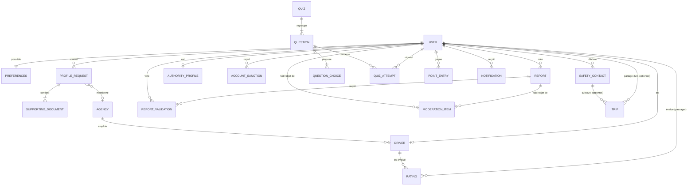

<!-- /diagram -->

<details>
<summary><strong>MLD : tables, clés et attributs</strong></summary>

<!-- diagram:docs/diagrams/08-data-model.md#2 -->

```mermaid
erDiagram
    USERS {
        uuid id PK
        string first_name
        string last_name
        string phone UK "format E.164 (+237...)"
        string password_hash "géré par le service d'authentification"
        string photo_url "nullable"
        enum role "CITIZEN, DRIVER, AUTHORITY, ADMIN"
        enum status "ACTIVE, SUSPENDED"
        datetime suspended_until "nullable"
        datetime created_at
        datetime updated_at
    }
    USER_PREFERENCES {
        uuid user_id PK, FK
        boolean nearby_danger_alerts
        int nearby_radius_km
        boolean quiz_reminders
        string language
    }
    SAFETY_CONTACTS {
        uuid id PK
        uuid user_id FK
        string name
        string phone
        string relation "nullable"
    }
    AGENCIES {
        uuid id PK
        string name
        string city
    }
    PROFILE_REQUESTS {
        uuid id PK
        uuid user_id FK
        enum requested_role "DRIVER, AUTHORITY"
        enum status "PENDING, APPROVED, REJECTED"
        uuid agency_id FK "nullable, Conducteur"
        string organization "nullable, Autorité"
        string position "nullable, Autorité"
        datetime submitted_at
        datetime reviewed_at "nullable"
        uuid reviewed_by FK "nullable, USERS"
        text rejection_reason "nullable"
    }
    SUPPORTING_DOCUMENTS {
        uuid id PK
        uuid profile_request_id FK
        enum type "ID_CARD, DRIVING_LICENSE, FUNCTION_PROOF"
        string file_key "clé dans le stockage objet privé"
        datetime uploaded_at
    }
    DRIVERS {
        uuid user_id PK, FK
        uuid agency_id FK
        datetime validated_at
    }
    AUTHORITY_PROFILES {
        uuid user_id PK, FK
        string organization
        string position
        datetime validated_at
    }
    ACCOUNT_SANCTIONS {
        uuid id PK
        uuid user_id FK
        string reason
        datetime starts_at
        datetime ends_at "nullable = jusqu'à réactivation"
        uuid created_by FK "nullable = automatique"
    }
    REPORTS {
        uuid id PK
        uuid author_id FK
        string client_id UK "idempotence de la synchro hors ligne"
        enum category
        enum severity
        enum affected_group
        decimal latitude "voir note géolocalisation"
        decimal longitude
        decimal accuracy_m "nullable"
        string city
        string photo_key "nullable"
        enum status
        enum origin "ONLINE, OFFLINE_SYNCED"
        int confirmations "dénormalisé"
        int refutations "dénormalisé"
        datetime occurred_at
        datetime created_at
        datetime validated_at "nullable, seuil de validation atteint"
        uuid handled_by FK "nullable, Autorité"
        datetime handled_at "nullable"
        datetime closed_at "nullable"
    }
    REPORT_VALIDATIONS {
        uuid id PK
        uuid report_id FK
        uuid user_id FK
        enum verdict "CONFIRM, REFUTE"
        datetime created_at
    }
    MODERATION_ITEMS {
        uuid id PK
        enum target_type "REPORT, ACCOUNT"
        uuid report_id FK "nullable"
        uuid user_id FK "nullable"
        enum reason
        enum status "OPEN, RESOLVED"
        string decision "nullable"
        uuid resolved_by FK "nullable"
        datetime created_at
        datetime resolved_at "nullable"
    }
    QUIZZES {
        uuid id PK
        string title
        enum theme
        boolean is_active
        boolean is_placeholder_content
        datetime created_at
    }
    QUESTIONS {
        uuid id PK
        uuid quiz_id FK
        text statement
        uuid correct_choice_id FK
        text explanation
        int position
    }
    QUESTION_CHOICES {
        uuid id PK
        uuid question_id FK
        string label
        int position
    }
    QUIZ_ATTEMPTS {
        uuid id PK
        uuid user_id FK
        uuid question_id FK
        uuid choice_id FK
        boolean is_correct
        string local_day "AAAA-MM-JJ, fuseau Africa/Douala"
        datetime answered_at
    }
    POINT_ENTRIES {
        uuid id PK
        uuid user_id FK
        enum reason
        int points
        string source_type
        uuid source_id
        datetime created_at
    }
    RATINGS {
        uuid id PK
        uuid passenger_id FK
        uuid driver_id FK
        uuid agency_id FK "agence au moment de l'évaluation"
        int courtesy "1 à 5"
        int punctuality "1 à 5"
        int safe_driving "1 à 5"
        int vehicle_cleanliness "1 à 5"
        string period_key "UK avec passenger_id et driver_id"
        datetime created_at
    }
    NOTIFICATIONS {
        uuid id PK
        uuid user_id FK
        enum type
        string title
        text body
        json data "nullable"
        datetime created_at
        datetime read_at "nullable"
    }
    TRIPS {
        uuid id PK
        uuid user_id FK
        uuid safety_contact_id FK
        enum status
        string share_token UK
        datetime started_at
        datetime expires_at
    }

    USERS ||--|| USER_PREFERENCES : ""
    USERS ||--o{ SAFETY_CONTACTS : ""
    USERS ||--o{ PROFILE_REQUESTS : ""
    PROFILE_REQUESTS ||--|{ SUPPORTING_DOCUMENTS : ""
    AGENCIES ||--o{ PROFILE_REQUESTS : ""
    USERS ||--o| DRIVERS : ""
    AGENCIES ||--o{ DRIVERS : ""
    USERS ||--o| AUTHORITY_PROFILES : ""
    USERS ||--o{ ACCOUNT_SANCTIONS : ""
    USERS ||--o{ REPORTS : ""
    REPORTS ||--o{ REPORT_VALIDATIONS : ""
    USERS ||--o{ REPORT_VALIDATIONS : ""
    REPORTS ||--o{ MODERATION_ITEMS : ""
    USERS ||--o{ MODERATION_ITEMS : ""
    QUIZZES ||--|{ QUESTIONS : ""
    QUESTIONS ||--|{ QUESTION_CHOICES : ""
    USERS ||--o{ QUIZ_ATTEMPTS : ""
    QUESTIONS ||--o{ QUIZ_ATTEMPTS : ""
    USERS ||--o{ POINT_ENTRIES : ""
    USERS ||--o{ RATINGS : ""
    DRIVERS ||--o{ RATINGS : ""
    AGENCIES ||--o{ RATINGS : ""
    USERS ||--o{ NOTIFICATIONS : ""
    USERS ||--o{ TRIPS : ""
    SAFETY_CONTACTS ||--o{ TRIPS : ""
```

<!-- /diagram -->

</details>

Contraintes d'intégrité et points à adapter selon le SGBD (géolocalisation PostGIS ou MySQL spatial, UUID, énumérations, authentification, RLS) : [docs/diagrams/08-data-model.md](docs/diagrams/08-data-model.md#84-points-à-adapter-selon-le-sgbd-retenu).

## 8. Roadmap

| Phase | Contenu                                                                        | Statut         |
| ----- | ------------------------------------------------------------------------------ | -------------- |
| 0     | Cadrage, architecture, documentation                                           | ✅ Terminée    |
| 1     | Fondations : monorepo, packages partagés, app client (Expo), design system, CI | ✅ Terminée    |
| 2     | M1 Comptes et profils                                                          | ✅ Terminée    |
| 3     | M2 Signalements et carte                                                       | 🔵 En revue    |
| 4     | M3 Mode hors ligne                                                             | ⬜             |
| 5     | M5 Quiz, points, classements                                                   | ⬜             |
| 6     | M6 Évaluation des conducteurs                                                  | ⬜             |
| 7     | M7 Notifications                                                               | ⬜             |
| 8     | Back-office : fondations, validation des profils, modération                   | ⬜             |
| 9     | Back-office : quiz, KPI et heatmap, export CSV, vue Autorité                   | ⬜             |
| 10    | M4 Partage de trajet + M8 Mode conduite                                        | ⏸️ Optionnelle |
| 11    | Build Android (APK de test)                                                    | ⬜             |
| 12    | Backend et base de données réels                                               | ⬜             |
| 13    | Sécurité, qualité, préparation de la publication                               | ⬜             |

Détail, branches et définition de terminé : [ROADMAP.md](ROADMAP.md). Rattachement des exigences : [matrice de traçabilité](docs/architecture/traceability.md).

## 9. Workflow Git

- `main` est stable : **jamais de push direct**, ni de force-push.
- **Une branche par phase** (`phase/NN-nom-court`), créée depuis `main` à jour.
- Commits **Conventional Commits** en anglais (`feat:`, `fix:`, `docs:`, `chore:`, `test:`, `refactor:`).
- **Une PR par phase** vers `main`, avec le [modèle de PR](.github/PULL_REQUEST_TEMPLATE.md). Le responsable du projet relit et **merge lui-même**.
- La phase suivante démarre seulement après le merge.

Détails : [CONTRIBUTING.md](CONTRIBUTING.md).

## 10. Application client (`apps/mobile`)

> Disponible : accueil, connexion, inscription (Citoyen, Conducteur ou Autorité), mot de passe oublié, profil (modification, photo, préférences, contacts de sécurité, demande de profil, justificatifs), carte publique des signalements et filtres, formulaire « Signaler », « Mes signalements », détail d'un signalement avec « Je confirme » / « C'est faux », onglets et espace Conducteur. Les autres écrans métier arrivent phase par phase ([ROADMAP.md](ROADMAP.md)). L'app n'affiche aucune information sur les phases ni sur l'avancement du projet : une fonctionnalité pas encore livrée est seulement indiquée « Bientôt disponible ».

**Prérequis** : Node.js 24 LTS (fixé dans `.nvmrc` ; Node 26 fonctionne aussi), npm 10 ou plus. Pour Android : un téléphone Android 8+ avec Expo Go, ou un émulateur (Android Studio).

```bash
npm ci                       # à la racine du dépôt (npm workspaces, versions du lockfile)
npm run dev:mobile           # serveur de développement, ouvre l'app dans le navigateur
npm run start:mobile         # serveur de développement + QR code à scanner avec Expo Go
npm run android              # serveur de développement + ouverture sur Android (téléphone USB ou émulateur)
npm run build:mobile         # export web statique dans apps/mobile/dist
npm run export:android -w @wakasafe/mobile   # vérifie que le bundle Android se construit
```

**Tester sur un téléphone Android physique (Expo Go)**. Il n'est pas nécessaire d'installer Android Studio : l'app tourne dans **Expo Go**, qui doit être compatible avec le **SDK 58** (version du Play Store ou [expo.dev/go](https://expo.dev/go)).

1. Mettre le PC et le téléphone sur le **même réseau Wi-Fi**. Le partage de connexion du téléphone convient aussi.
2. Lancer `npm run start:mobile`, puis scanner le QR code affiché dans le terminal depuis Expo Go. Le premier chargement prend une à deux minutes. Ensuite, chaque modification enregistrée se recharge sur le téléphone.
3. Si le téléphone ne trouve pas le PC, il y a deux solutions :
   - **Câble USB** : activer le débogage USB sur le téléphone et installer les [Android platform-tools](https://developer.android.com/tools/releases/platform-tools) (`adb`). Lancer `adb reverse tcp:8081 tcp:8081`, puis saisir `exp://127.0.0.1:8081` dans Expo Go.
   - **Tunnel** : lancer `npx expo start --tunnel` dans `apps/mobile`.

Sous Windows, autoriser Node.js dans le pare-feu (réseau **privé**) quand Windows le demande au premier lancement.

Variables d'environnement (facultatives) : copier [`.env.example`](.env.example) dans `apps/mobile/.env.local`. Détail : [docs/architecture/overview.md](docs/architecture/overview.md#variables-denvironnement).

**URL de démonstration** : **<https://wakasafe-client.vercel.app>** (version de `main`, active dès la fusion de la phase 1). Chaque PR reçoit en plus sa propre URL de prévisualisation (voir [section 13](#13-déploiement-de-la-démo)).

**Comptes de démonstration** (fictifs, données mock). On s'y connecte avec l'écran **« Se connecter »** (téléphone et mot de passe), ou en un geste depuis le lien **« Essayer un profil de démonstration »** de l'accueil. On peut aussi créer son propre compte : il reste sur l'appareil.

| Profil                | Téléphone         | Mot de passe    | Particularité                                                             |
| --------------------- | ----------------- | --------------- | ------------------------------------------------------------------------- |
| Citoyenne             | +237 600 00 00 01 | `demo-wakasafe` | Nadège Atangana, Yaoundé : historique de signalements et de points        |
| Conducteur validé     | +237 600 00 00 02 | `demo-wakasafe` | Paul Ekwalla, agence fictive (Douala) : accès à l'espace Conducteur       |
| Conducteur en attente | +237 600 00 00 03 | `demo-wakasafe` | Samuel Fotso, Bafoussam : demande en attente, droits Citoyen              |
| Autorité              | +237 600 00 00 04 | `demo-wakasafe` | Brigitte Ngo Mbock : droits Citoyen dans l'app, vue Autorité dans l'admin |
| Compte suspendu       | +237 600 00 01 05 | `demo-wakasafe` | Hervé Nkoulou : suspension temporaire, lecture seule                      |

Les numéros, noms et agences de démonstration sont **fictifs**. Aucune agence réelle n'est évaluée avec des données inventées. Le mot de passe de démonstration est public et ne protège aucune donnée réelle.

**Particularités de la démo pour les comptes** :

- Mot de passe oublié : aucun SMS n'est envoyé, le code à 6 chiffres s'affiche à l'écran. Il est valable 10 minutes, avec 5 essais au plus.
- Les photos (profil et justificatifs) sont compressées puis enregistrées sur l'appareil, avec les autres données de démo.
- Les conditions d'utilisation affichées sont un texte provisoire, en attendant le texte de GOSAFE.
- Une demande Conducteur ou Autorité reste « en attente » dans l'app : sa validation se fait dans le back-office (phase 8), qui ne partage pas ses données avec l'app en démo (voir [section 13](#13-déploiement-de-la-démo)).

**Particularités de la démo pour les signalements** :

- La carte interactive (Leaflet, tuiles OpenStreetMap) s'affiche sur le web. Sur Android (Expo Go), la carte affiche « Bientôt disponible » et l'écran montre la liste des signalements : la carte native arrive avec le build Android (phase 11).
- Le navigateur ou le téléphone demande l'autorisation de localisation. En cas de refus, on choisit la ville (Yaoundé, Douala ou Bafoussam) ou, sur le web, on place le point sur la carte.
- La zone d'un signalement est la ville pilote la plus proche. Seuls les signalements actifs (en attente, validés, pris en charge) apparaissent sur la carte publique.
- Pour voir un signalement passer « Validé », se connecter avec la Citoyenne et confirmer le signalement « Éclairage public défectueux » de Bonapriso (Douala), qui a déjà 2 confirmations (seuil : 3). Son auteur gagne 10 points.
- Les alertes aux usagers proches et la notification de l'auteur arrivent avec le centre de notifications (phase 7) ; la file de modération des suspects, avec le back-office (phase 8).

## 11. Back-office (`apps/admin`)

> ⏳ Disponible à partir de la **phase 8**. Commandes prévues :

```bash
npm install                  # à la racine du dépôt
npm run dev:admin            # lance le back-office (Next.js) en local
npm run build:admin          # build de production Next.js
```

**URL de démonstration** : _à venir (projet Vercel « wakasafe-admin », phase 8)_.

**Comptes de démonstration** (fictifs, disponibles à partir de la phase 8) :

| Profil         | Téléphone         | Mot de passe    | Accès                          |
| -------------- | ----------------- | --------------- | ------------------------------ |
| Administrateur | +237 600 00 00 00 | `demo-wakasafe` | Tout le back-office            |
| Autorité       | +237 600 00 00 04 | `demo-wakasafe` | Vue Autorité uniquement (F9.7) |

> ⚠️ En démo, l'authentification du back-office est **simulée** : elle ne protège aucune donnée réelle. La connexion sécurisée réelle arrive avec le backend (phase 12).

## 12. Tests et qualité

Commandes à lancer à la racine ; elles couvrent tous les workspaces :

```bash
npm run lint             # ESLint (0 avertissement toléré) + Prettier --check
npm run format           # applique Prettier
npm run typecheck        # tsc --noEmit dans chaque workspace (TypeScript strict)
npm test                 # Jest dans chaque workspace (Testing Library pour les écrans)
npm run build            # builds de tous les workspaces (aujourd'hui : export web du client)
npm run check:diagrams   # les diagrammes du README sont identiques à docs/diagrams/
npm run sync:diagrams    # recopie les diagrammes de docs/diagrams/ dans le README
```

La **CI GitHub Actions** ([`.github/workflows/ci.yml`](.github/workflows/ci.yml)) s'exécute sur chaque PR et sur `main` :

- **Qualité** : installation propre (`npm ci`), lint, typecheck, tests, export web du client et export du bundle Android ;
- **Documentation** : `check:diagrams`, puis rendu de chaque diagramme Mermaid avec `mermaid-cli` (un diagramme invalide fait échouer la CI).

Le build Next.js du back-office rejoindra la CI en phase 8.

Priorités de test : règles métier de `packages/domain` (seuils, quotas, anti-abus, 5 questions par jour, classements), implémentations mock, parcours principaux des écrans (gardes de routes par rôle, session).

## 13. Déploiement de la démo

Deux projets **Vercel** distincts, reliés à ce dépôt, chacun avec une **URL de prévisualisation par PR** ([ADR-0008](docs/adr/0008-demo-hosting-vercel.md)) :

| Projet            | Dossier racine | Installation         | Build                                          | Sortie                  |
| ----------------- | -------------- | -------------------- | ---------------------------------------------- | ----------------------- |
| `wakasafe-client` | `apps/mobile`  | `cd ../.. && npm ci` | `npm run build` (`expo export --platform web`) | `dist/` (site statique) |
| `wakasafe-admin`  | `apps/admin`   | à définir en phase 8 | `next build`                                   | préréglage Next.js      |

La configuration du client est versionnée dans [`apps/mobile/vercel.json`](apps/mobile/vercel.json) : installation depuis la racine du monorepo, réécriture de toutes les URL vers `index.html` (liens directs et rafraîchissement), cache long des fichiers statiques.

**Projet `wakasafe-client`** (connecté le 2026-11-24) : URL de production **<https://wakasafe-client.vercel.app>**, qui suit `main`. Réglages indispensables dans Vercel (Settings → Build and Deployment) :

- **Root Directory** : `apps/mobile`. Sans ce réglage, Vercel ignore `apps/mobile/vercel.json` et le build échoue (« No Output Directory named "public" found »).
- **Include files outside the root directory** : activé (accès à `packages/`).
- **Framework Preset** : « Other » ; commandes laissées vides (lues dans `vercel.json`).
- **Node.js Version** : 24.x, comme la CI et `.nvmrc`.

Les URL de prévisualisation des PR sont protégées par Vercel Authentication : seuls les membres du compte Vercel les ouvrent. Le client utilise l'URL de production.

Le responsable du projet crée les comptes et connecte le dépôt. Aucun secret n'est versionné.

### ⚠️ Limite connue du mode démo

Les deux apps sont servies sur **deux URL différentes**, et chacune stocke ses données mock **localement** (navigateur ou téléphone). Elles démarrent avec **les mêmes jeux de données**, mais une action faite dans le back-office (par exemple valider un profil Conducteur) **ne se répercute pas en direct** dans l'app client, et inversement. La synchronisation réelle arrivera avec le backend (phase 12).

## 14. Décisions d'architecture (ADR)

| N°                                                              | Décision                                                   | Statut  |
| --------------------------------------------------------------- | ---------------------------------------------------------- | ------- |
| [0001](docs/adr/0001-two-web-applications.md)                   | Deux applications web : client Expo et back-office Next.js | Accepté |
| [0002](docs/adr/0002-monorepo-npm-workspaces.md)                | Monorepo avec npm workspaces                               | Accepté |
| [0003](docs/adr/0003-client-app-stack.md)                       | Stack de l'application client                              | Accepté |
| [0004](docs/adr/0004-admin-app-stack.md)                        | Stack du back-office                                       | Accepté |
| [0005](docs/adr/0005-data-access-abstraction.md)                | Abstraction des données et mocks                           | Accepté |
| [0006](docs/adr/0006-maps-openstreetmap.md)                     | Cartographie OSM et composant `AppMap`                     | Accepté |
| [0007](docs/adr/0007-notifications-in-app-first.md)             | Notifications in-app d'abord, FCM plus tard                | Accepté |
| [0008](docs/adr/0008-demo-hosting-vercel.md)                    | Hébergement de la démo sur Vercel                          | Accepté |
| [0009](docs/adr/0009-profile-requests-and-authority-access.md)  | Demandes de profil et accès Autorité au back-office        | Accepté |
| [0010](docs/adr/0010-confidential-source-documents.md)          | Documents sources confidentiels hors du dépôt              | Accepté |
| [0011](docs/adr/0011-provisional-theme-and-brand-guidelines.md) | Thème provisoire et passage à la charte GOSAFE             | Accepté |

## 15. Hypothèses et points ouverts

**Hypothèses retenues** (modifiables) :

- Les paramètres métier (seuils de validation, quotas, barème de points, période anti-abus, rayon d'alerte…) sont **provisoires et configurables** : [business-rules.md](docs/architecture/business-rules.md).
- Les questions de quiz de démonstration sont marquées **« Contenu provisoire, à remplacer par le contenu GOSAFE »**.
- Le thème graphique est **neutre et provisoire**, modifiable à un seul endroit (`packages/design-tokens`), en attendant la charte GOSAFE. La procédure de changement de charte est décrite dans l'[ADR-0011](docs/adr/0011-provisional-theme-and-brand-guidelines.md).
- Nom affiché : **WakaSafe**.

**Points ouverts** :

| Point                                                                                                           | Échéance          |
| --------------------------------------------------------------------------------------------------------------- | ----------------- |
| Choix de la base de données : MySQL ou Supabase/PostgreSQL (le cahier des charges propose PostgreSQL + PostGIS) | Avant la phase 12 |
| Activation de M4 (partage de trajet) et M8 (mode conduite)                                                      | Avant la phase 10 |
| Validation des paramètres métier et des listes (gravité, personnes concernées) par GOSAFE                       | Phases 3 à 6      |
| Contenus GOSAFE : questions de quiz, charte graphique, logo, CGU, politique de confidentialité                  | Au plus tôt       |
| Fournisseur de tuiles cartographiques pour la production                                                        | Avant la phase 13 |
| Comptes d'hébergement, Firebase et Google Play au nom de GOSAFE                                                 | Avant la phase 12 |
| Périmètre contractuel de la phase 13 (sécurité, mise en production)                                             | Avant la phase 13 |

## 16. Contribuer

Voir [CONTRIBUTING.md](CONTRIBUTING.md) : langues, workflow Git, Conventional Commits, définition de terminé, règles d'architecture, confidentialité.

## 17. Propriété et licence

Le code source, la documentation et les données de WakaSafe appartiennent à l'**Association GOSAFE** à la fin du paiement du projet. Tous droits réservés : aucune licence open source n'est accordée à ce jour, même si le dépôt est consultable publiquement.
