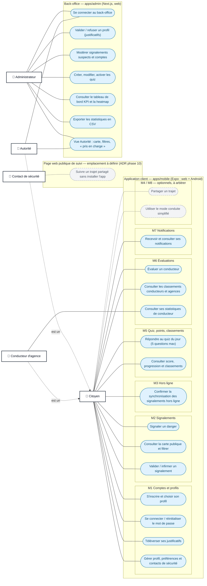

# 1. Diagramme de cas d'utilisation

> Source de vérité de ce diagramme. Toute modification doit être reportée dans le [README](../../README.md).
> Une version PlantUML en notation UML stricte est disponible dans [`01-use-cases.puml`](01-use-cases.puml).

Mermaid ne propose pas de type « cas d'utilisation » natif. La notation est reproduite avec un flowchart :

- **acteurs** : rectangles avec l'icône 👤, à gauche ;
- **cas d'utilisation** : ellipses (formes arrondies), regroupées par module ;
- **frontières du système** : un cadre par application (client Expo, back-office Next.js) ;
- **généralisation** : flèche pointillée « est un » (le Conducteur et l'Autorité héritent de tous les cas du Citoyen) ;
- **optionnel (M4, M8)** : cas grisés, à arbitrer (phase 10).

## Lecture

| Acteur              | Application       | Cas d'utilisation                                                                                                                                                |
| ------------------- | ----------------- | ---------------------------------------------------------------------------------------------------------------------------------------------------------------- |
| Citoyen             | Client            | UC1 à UC12, UC14 (et UC15, UC17 si M4/M8 activés)                                                                                                                |
| Conducteur d'agence | Client            | Tous ceux du Citoyen + UC13. UC3 obligatoire (identité, permis, agence affiliée).                                                                                |
| Autorité            | Client + Admin    | Tous ceux du Citoyen dans l'app client ; dans l'admin, uniquement UC20 et UC26 (vue Autorité, [ADR-0009](../adr/0009-profile-requests-and-authority-access.md)). |
| Administrateur      | Admin             | UC20 à UC26. Compte créé par le prestataire, pas d'inscription publique.                                                                                         |
| Contact de sécurité | Page web publique | UC16 (M4, optionnel).                                                                                                                                            |

Règle validée ([ADR-0009](../adr/0009-profile-requests-and-authority-access.md)) : tant que la demande de profil Conducteur ou Autorité est en attente, l'utilisateur dispose des droits Citoyen. Les cas UC13 et UC26 sont verrouillés jusqu'à la validation.
