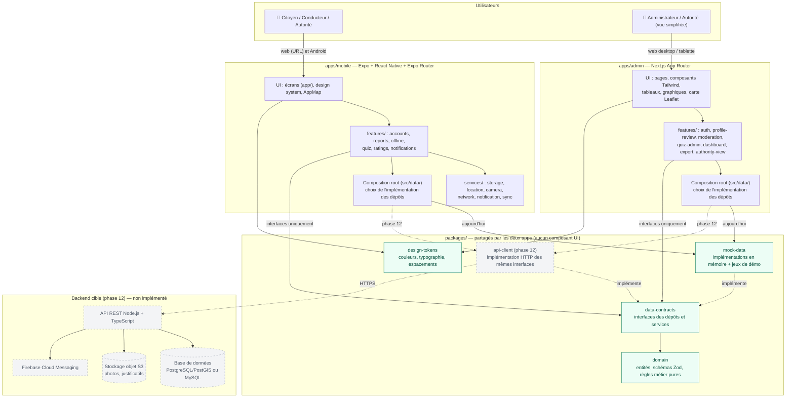

# 2. Diagramme d'architecture globale

> Source de vérité de ce diagramme. Toute modification doit être reportée dans le [README](../../README.md).
> Décisions associées : [ADR-0001](../adr/0001-two-web-applications.md), [ADR-0002](../adr/0002-monorepo-npm-workspaces.md), [ADR-0005](../adr/0005-data-access-abstraction.md).

Pour la lisibilité, le diagramme omet les flèches des features vers `domain` : les features importent aussi directement les entités et les règles métier (voir le tableau ci-dessous).

## Règles de dépendance (vérifiées par ESLint)

La CI fait échouer tout import qui viole ces règles : `no-restricted-imports` interdit `mock-data` hors de la composition root et les frameworks dans les packages ; `import/no-extraneous-dependencies` (types compris) interdit à un package d'importer ce que son `package.json` ne déclare pas. Configuration : [`eslint.config.js`](../../eslint.config.js).

| Couche                         | Peut importer                                    | Ne doit jamais importer                                   |
| ------------------------------ | ------------------------------------------------ | --------------------------------------------------------- |
| `packages/domain`              | rien d'autre que `zod`                           | React, React Native, Next.js, un autre package applicatif |
| `packages/data-contracts`      | `domain`                                         | une implémentation (`mock-data`, `api-client`)            |
| `packages/mock-data`           | `domain`, `data-contracts`                       | React, React Native, Next.js, API navigateur ou native    |
| `packages/design-tokens`       | rien                                             | tout le reste                                             |
| `features/` (dans chaque app)  | `domain`, `data-contracts`, `services/`, `ui/`   | `mock-data` ou `api-client` directement                   |
| Composition root (`src/data/`) | `mock-data` (aujourd'hui), `api-client` (demain) | — c'est le **seul** endroit autorisé                      |

Conséquence : brancher la vraie API (phase 12) consiste à écrire `api-client` et à modifier la composition root de chaque app. L'UI et les features ne changent pas.

## Limite connue du mode démo

Les deux apps sont servies sur deux URL distinctes et chacune stocke ses données mock localement (navigateur ou téléphone). Elles démarrent avec **les mêmes jeux de données**, mais une action faite dans l'admin (par exemple valider un profil Conducteur) **n'apparaît pas en direct** dans l'app client. La synchronisation réelle viendra avec le backend (phase 12).
