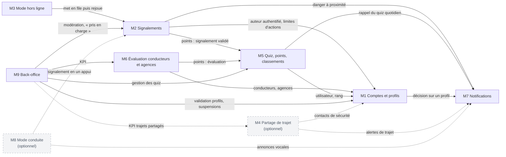
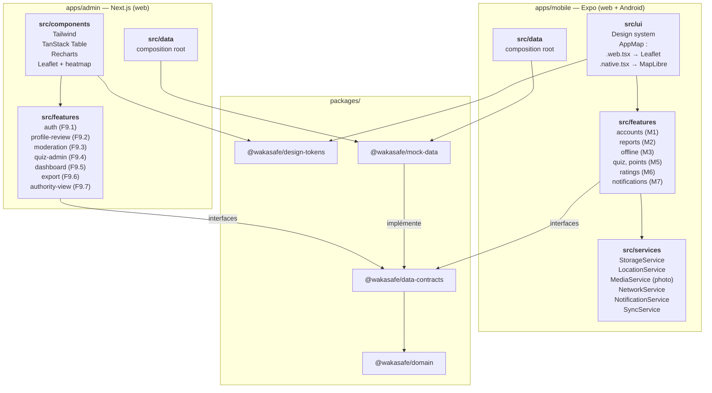

# 3. Diagramme de composants et de modules

> Source de vérité de ce diagramme. Toute modification doit être reportée dans le [README](../../README.md).

## 3.1 Modules fonctionnels (M1 à M9) et dépendances

Une flèche `A --> B` signifie « A utilise B ».

Tant que M4 n'est pas activé, les alertes de trajet (F7.2) et le KPI « trajets partagés » (F9.5) sont affichés comme « non disponible » ([ADR-0007](../adr/0007-notifications-in-app-first.md)).

## 3.2 Composants logiciels par application

Dépendances détaillées entre features et services de `apps/mobile` :

| Feature (module)     | Services et composants utilisés                                                                       |
| -------------------- | ----------------------------------------------------------------------------------------------------- |
| `reports` (M2)       | `LocationService`, `MediaService` (photo), `AppMap`                                                   |
| `offline` (M3)       | `SyncService`, qui s'appuie sur `NetworkService` (détection réseau) et `StorageService` (file locale) |
| `notifications` (M7) | `NotificationService` (centre in-app + toasts, FCM plus tard)                                         |
| toutes               | interfaces de `@wakasafe/data-contracts` et types de `@wakasafe/domain`                               |

## 3.3 Interfaces exposées par `@wakasafe/data-contracts`

| Interface                  | Modules    | Principales opérations                                                                                                                                                          |
| -------------------------- | ---------- | ------------------------------------------------------------------------------------------------------------------------------------------------------------------------------- |
| `AuthRepository`           | M1, M9     | `register`, `login`, `logout`, `getSession`, `requestPasswordReset`, `resetPassword`                                                                                            |
| `UserRepository`           | M1, M9     | `getById`, `list(filters)`, `updateProfile`, `getPreferences`, `updatePreferences`, `listSafetyContacts`, `upsertSafetyContact`, `removeSafetyContact`, `suspend`, `reactivate` |
| `ProfileRequestRepository` | M1, M9     | `submit`, `uploadDocument`, `getForUser`, `listDocuments`, `listPending`, `approve`, `reject`                                                                                   |
| `AgencyRepository`         | M1, M6     | `list`, `getById` (agences de rattachement des conducteurs)                                                                                                                     |
| `ReportRepository`         | M2, M3, M9 | `getActionQuota`, `create`, `list(filters)`, `getById`, `getUserVote`, `vote(confirm/refute)`, `markHandled`, `close`                                                           |
| `ModerationRepository`     | M2, M9     | `listOpen`, `resolve`                                                                                                                                                           |
| `QuizRepository`           | M5, M9     | `getDailyQuestions`, `answer`, `listQuizzes`, `getQuestions`, `upsertQuiz`, `setActive`                                                                                         |
| `PointsRepository`         | M5         | `listEntries`, `getScore`, `getLeaderboard(monthly/annual)`                                                                                                                     |
| `RatingRepository`         | M6         | `getRatingEligibility`, `submit`, `listDrivers`, `listAgencies`, `getDriverStats`                                                                                               |
| `NotificationRepository`   | M7         | `list`, `countUnread`, `markAsRead`, `markAllAsRead`, `push` (simulation)                                                                                                       |
| `StatsRepository`          | M9         | `getKpis`, `getHeatmap`, `exportRows`                                                                                                                                           |
| `KeyValueStore`            | toutes     | `get`, `set`, `remove` (persistance locale injectée dans les mocks)                                                                                                             |
| `Clock`                    | toutes     | `now` (horloge injectable : quotas, classements, tests)                                                                                                                         |

Signatures détaillées : [`packages/data-contracts/src`](../../packages/data-contracts/src). Les dépôts reçoivent l'identifiant de l'utilisateur concerné en paramètre explicite. En phase 1, les opérations des phases suivantes existent dans les mocks mais rejettent une erreur `NOT_IMPLEMENTED` qui indique leur phase.
