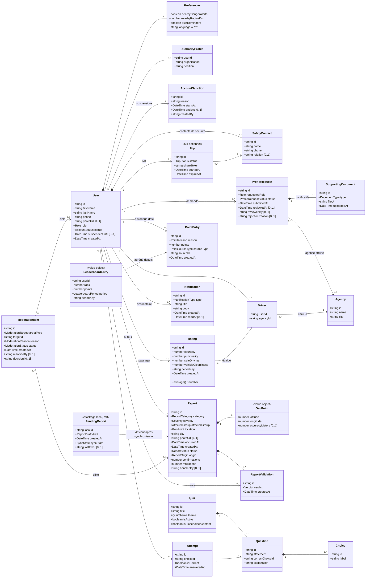

# 4. Diagramme de classes du domaine

> Source de vérité de ce diagramme. Toute modification doit être reportée dans le [README](../../README.md).
> Implémenté dans [`packages/domain`](../../packages/domain/src) (types TypeScript + schémas Zod) depuis la phase 1.
> Les valeurs des énumérations marquées _provisoire_ doivent être validées par GOSAFE ([règles métier](../architecture/business-rules.md)).

## Énumérations

Présentées sous forme de tableau : un diagramme de 19 énumérations sans relations est illisible avec Mermaid (une seule colonne ou une seule ligne).

| Énumération            | Valeurs                                                                                                                                                                                                             | Module | Remarque                                   |
| ---------------------- | ------------------------------------------------------------------------------------------------------------------------------------------------------------------------------------------------------------------- | ------ | ------------------------------------------ |
| `Role`                 | `CITIZEN`, `DRIVER`, `AUTHORITY`, `ADMIN`                                                                                                                                                                           | M1     |                                            |
| `AccountStatus`        | `ACTIVE`, `SUSPENDED`                                                                                                                                                                                               | M1     |                                            |
| `ProfileRequestStatus` | `PENDING`, `APPROVED`, `REJECTED`                                                                                                                                                                                   | M1     |                                            |
| `DocumentType`         | `ID_CARD`, `DRIVING_LICENSE`, `FUNCTION_PROOF`                                                                                                                                                                      | M1     |                                            |
| `ReportCategory`       | `ACCIDENT_CRITICAL`, `OBSTACLE`, `DAMAGED_BRIDGE`, `DANGEROUS_POTHOLE`, `SLIPPERY_OR_FLOODED_ROAD`, `LANDSLIDE`, `FAULTY_STREET_LIGHTING`, `TRAFFIC_LIGHT_FAILURE`, `POORLY_MARKED_ROADWORKS`, `PERSON_IN_DISTRESS` | M2     | les 10 catégories F2.1                     |
| `Severity`             | `LOW`, `MEDIUM`, `HIGH`, `CRITICAL`                                                                                                                                                                                 | M2     | provisoire                                 |
| `AffectedGroup`        | `PEDESTRIANS`, `MOTORCYCLISTS`, `CAR_DRIVERS`, `PUBLIC_TRANSPORT`, `CHILDREN_STUDENTS`, `ALL_ROAD_USERS`                                                                                                            | M2     | provisoire                                 |
| `ReportStatus`         | `CREATED`, `VALIDATED`, `INVALIDATED`, `SUSPICIOUS`, `HANDLED`, `CLOSED`                                                                                                                                            | M2     | voir diagramme 6.2                         |
| `ReportOrigin`         | `ONLINE`, `OFFLINE_SYNCED`                                                                                                                                                                                          | M2, M3 |                                            |
| `Verdict`              | `CONFIRM`, `REFUTE`                                                                                                                                                                                                 | M2     |                                            |
| `SyncState`            | `PENDING_CONFIRMATION`, `SYNCING`, `FAILED`                                                                                                                                                                         | M3     |                                            |
| `QuizTheme`            | `TRAFFIC_CODE`, `GOOD_REFLEXES`, `FIRST_AID`, `SPECIFIC_DANGERS`                                                                                                                                                    | M5     |                                            |
| `PointReason`          | `REPORT_VALIDATED`, `QUIZ_CORRECT_ANSWER`, `RATING_SUBMITTED`                                                                                                                                                       | M5     |                                            |
| `PointSourceType`      | `REPORT`, `QUIZ_ATTEMPT`, `RATING`                                                                                                                                                                                  | M5     | déduit de `PointReason` (traçabilité F5.3) |
| `LeaderboardPeriod`    | `MONTHLY`, `ANNUAL`                                                                                                                                                                                                 | M5     |                                            |
| `NotificationType`     | `NEARBY_DANGER`, `QUIZ_REMINDER`, `PROFILE_DECISION`, `AUTHORITY_INFO`, `ACCOUNT_SANCTION`, `TRIP_ALERT`                                                                                                            | M7     | `TRIP_ALERT` : M4                          |
| `ModerationTarget`     | `REPORT`, `ACCOUNT`                                                                                                                                                                                                 | M9     |                                            |
| `ModerationReason`     | `ABNORMAL_FREQUENCY`, `MANY_REFUTATIONS`, `ACTION_LIMIT_ABUSE`                                                                                                                                                      | M9     |                                            |
| `ModerationStatus`     | `OPEN`, `RESOLVED`                                                                                                                                                                                                  | M9     |                                            |
| `TripStatus`           | `ACTIVE`, `ALERT`, `ENDED`, `EXPIRED`                                                                                                                                                                               | M4     | optionnel                                  |

## Règles métier pures (dans `packages/domain`)

| Règle                   | Exigence | Description                                                                                          |
| ----------------------- | -------- | ---------------------------------------------------------------------------------------------------- |
| `ConsensusPolicy`       | F2.4     | Fait passer un signalement de `CREATED` à `VALIDATED` ou `INVALIDATED` selon des seuils de votes.    |
| `SuspicionPolicy`       | F2.5     | Détecte une fréquence anormale ou un signalement fortement contesté, et produit un `ModerationItem`. |
| `ActionLimitPolicy`     | F2.6     | Quotas périodiques par utilisateur ; une suspension temporaire est créée après des abus répétés.     |
| `DailyQuizLimit`        | F5.2     | 5 questions maximum par jour et par utilisateur (jour calendaire, fuseau Africa/Douala).             |
| `PointsPolicy`          | F5.3     | Barème des points par `PointReason`.                                                                 |
| `LeaderboardCalculator` | F5.4     | Classement mensuel (remis à zéro chaque mois) et annuel.                                             |
| `RatingAntiAbusePolicy` | F6.3     | Une évaluation par (passager, conducteur, période).                                                  |
| `RatingAggregator`      | F6.2     | Moyennes par critère, par conducteur et par agence.                                                  |

Les paramètres numériques (seuils, quotas, barème, durée de période) sont **provisoires et configurables**. Voir [`business-rules.md`](../architecture/business-rules.md).
