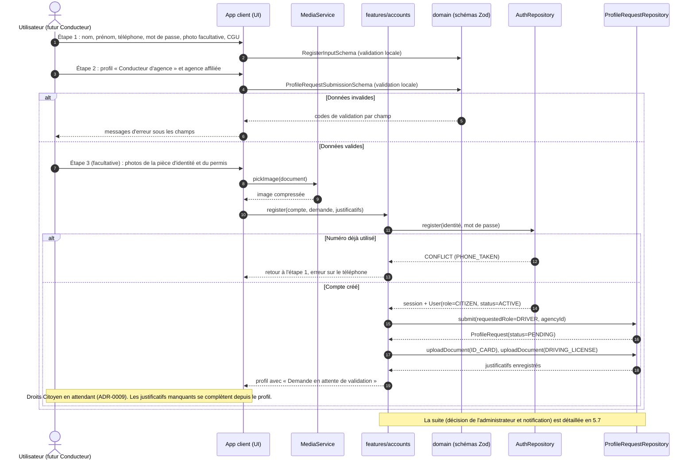
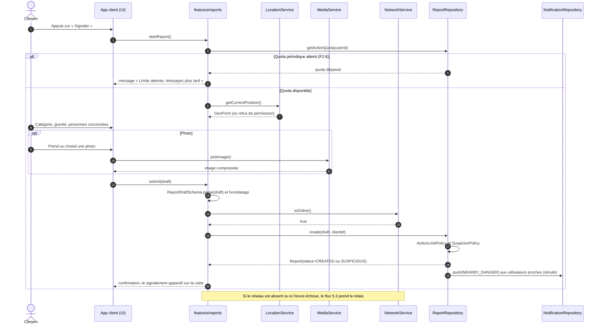
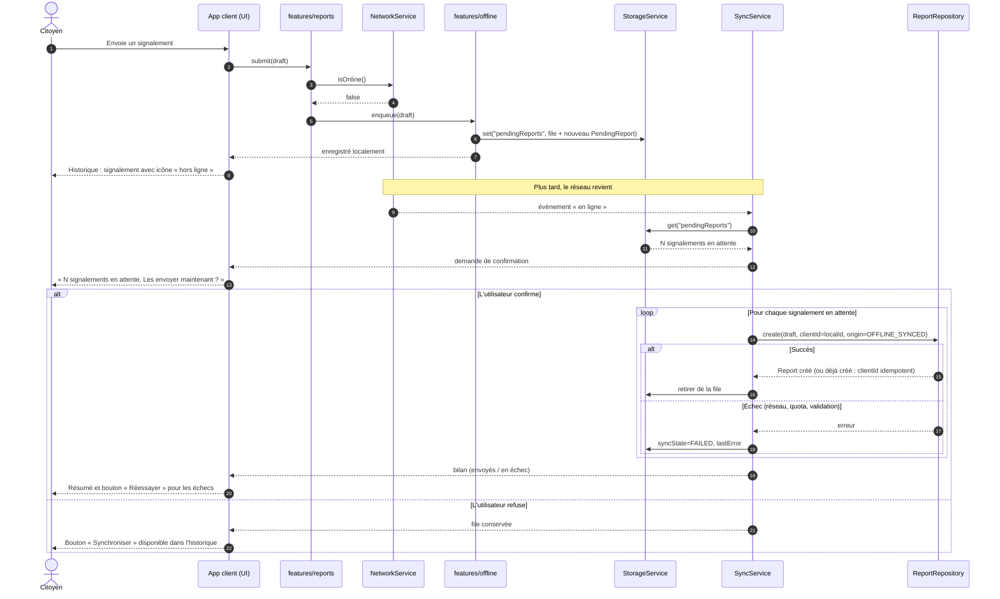
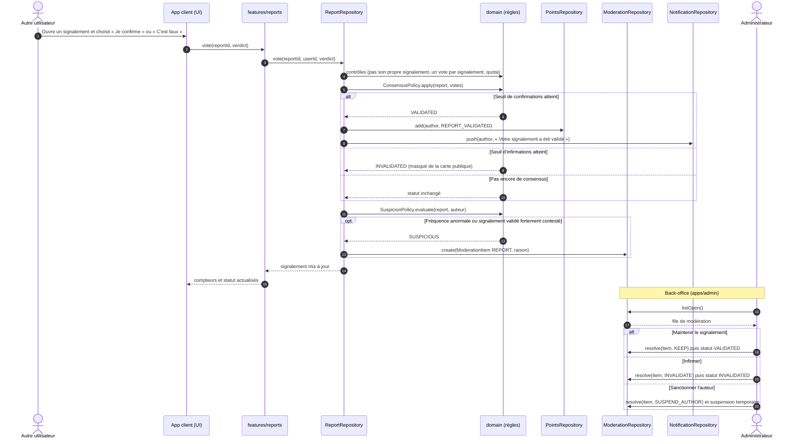
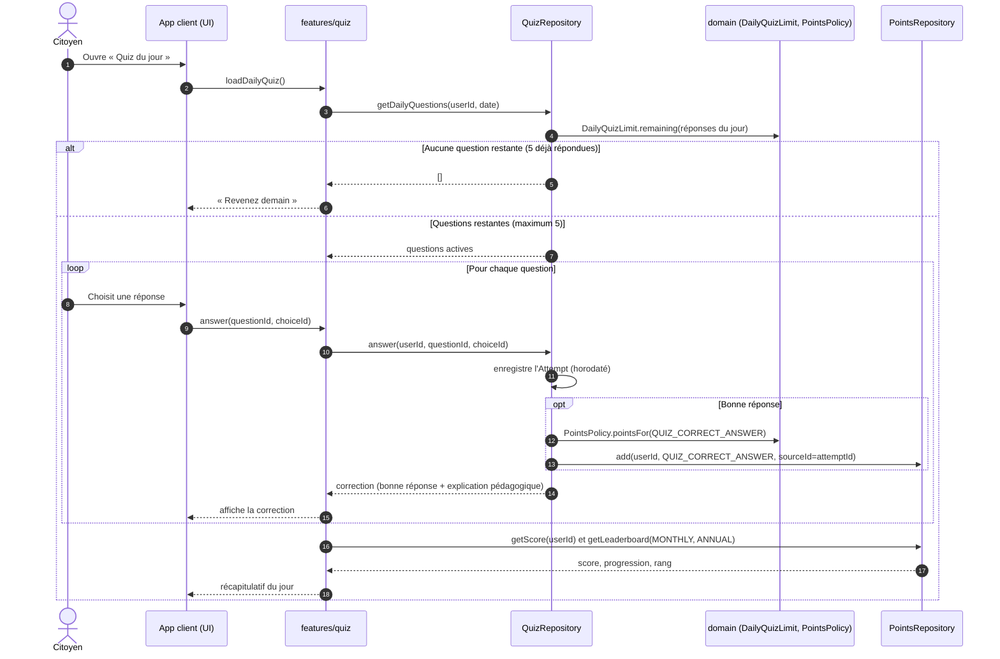
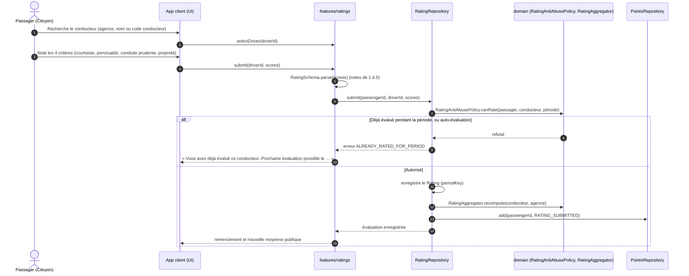
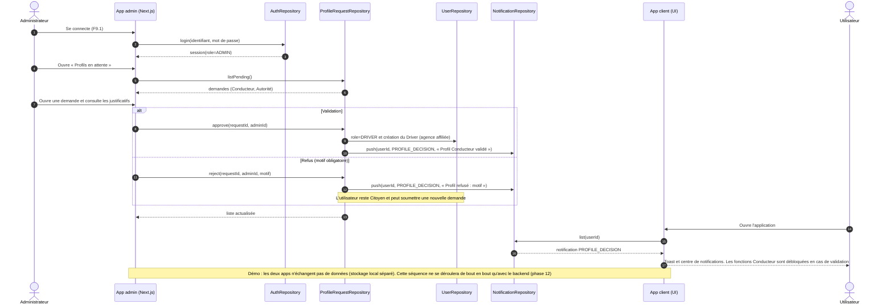

# 5. Diagrammes de séquence

> Source de vérité de ces diagrammes. Toute modification doit être reportée dans le [README](../../README.md).

Convention : l'UI appelle une **feature**, qui appelle une **interface** de `@wakasafe/data-contracts`. Les règles métier de `@wakasafe/domain` sont appliquées **par l'implémentation du dépôt** : le mock aujourd'hui, l'API demain. Le client les exécute aussi pour donner un retour immédiat à l'utilisateur, mais c'est l'implémentation du dépôt qui fait foi.

## 5.1 Inscription et demande de profil Conducteur (F1.1, F1.3, F1.4)

## 5.2 Création d'un signalement en ligne (F2.1, F2.2, F2.6, F7.1)

## 5.3 Signalement hors ligne puis synchronisation avec confirmation (F3.1, F3.2)

## 5.4 Validation communautaire et passage en modération (F2.4, F2.5, F5.3, F9.3)

## 5.5 Passage d'un quiz et attribution de points (F5.1, F5.2, F5.3, F5.5)

## 5.6 Évaluation d'un conducteur avec contrôle anti-abus (F6.1, F6.2, F6.3)

## 5.7 L'administrateur valide un profil Conducteur et l'utilisateur est notifié (F9.1, F9.2, F1.3)

