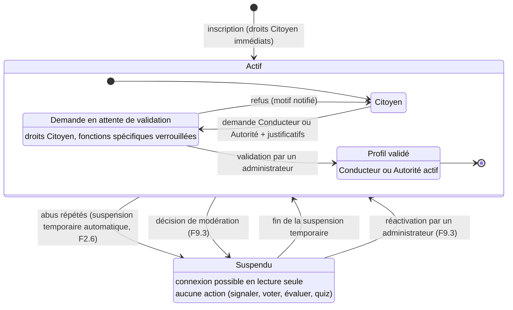
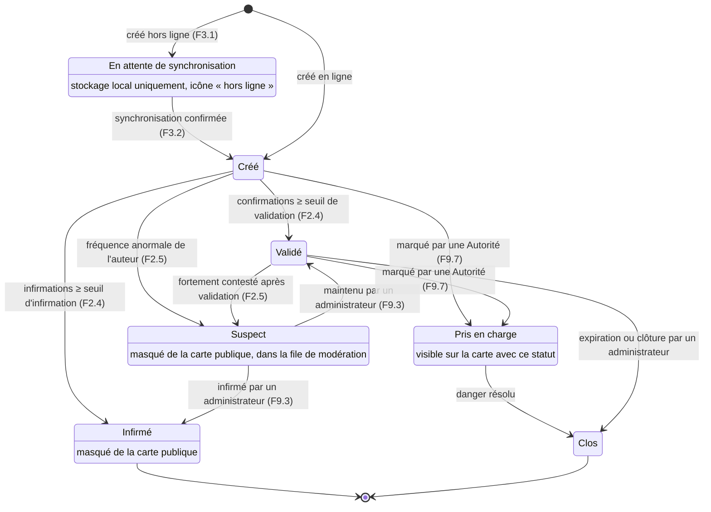

# 6. Diagrammes d'états

> Source de vérité de ces diagrammes. Toute modification doit être reportée dans le [README](../../README.md).

## 6.1 Cycle de vie d'un compte et d'une demande de profil

Conformément à [ADR-0009](../adr/0009-profile-requests-and-authority-access.md), l'état « en attente » ne bloque pas le compte. Il porte sur la **demande de profil** Conducteur ou Autorité. Le compte lui-même est soit actif, soit suspendu.

Les comptes Administrateur sont créés directement à l'état `Actif` par le prestataire, sans inscription publique.

## 6.2 Cycle de vie d'un signalement

| État                          | Code (`ReportStatus`)      | Visible sur la carte publique                 |
| ----------------------------- | -------------------------- | --------------------------------------------- |
| En attente de synchronisation | _(local, `PendingReport`)_ | Non (seulement dans l'historique de l'auteur) |
| Créé                          | `CREATED`                  | Oui, avec la mention « non vérifié »          |
| Validé                        | `VALIDATED`                | Oui                                           |
| Infirmé                       | `INVALIDATED`              | Non                                           |
| Suspect                       | `SUSPICIOUS`               | Non                                           |
| Pris en charge                | `HANDLED`                  | Oui                                           |
| Clos                          | `CLOSED`                   | Non (historique et statistiques uniquement)   |

Les seuils et la durée d'expiration sont provisoires et configurables ([règles métier](../architecture/business-rules.md)).
