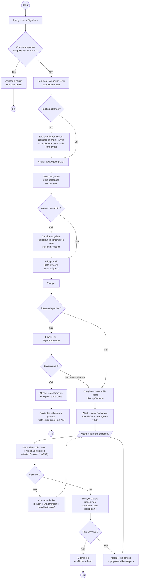

# 7. Diagramme d'activité : « Signaler un danger » (en ligne et hors ligne)

> Source de vérité de ce diagramme. Toute modification doit être reportée dans le [README](../../README.md).
> Exigences : F2.1, F2.2, F2.6, F3.1, F3.2, F7.1.

