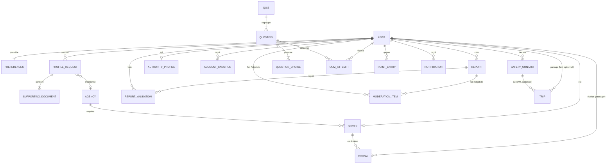

# 8. Modèle de données : MCD et MLD

> Source de vérité de ces diagrammes. Toute modification doit être reportée dans le [README](../../README.md).
> Ce modèle est **indépendant du SGBD**. Le choix MySQL ou Supabase/PostgreSQL sera fait avant la phase 12.
> En phases 1 à 11, ces structures sont simulées par `@wakasafe/mock-data`.

## 8.1 MCD : entités et associations

## 8.2 MLD : tables, clés et attributs

Types génériques utilisés : `uuid`, `string`, `text`, `int`, `decimal`, `boolean`, `datetime` (UTC), `enum` (liste fermée), `json`.

```mermaid
erDiagram
    USERS {
        uuid id PK
        string first_name
        string last_name
        string phone UK "format E.164 (+237...)"
        string password_hash "géré par le service d'authentification"
        string photo_url "nullable"
        enum role "CITIZEN, DRIVER, AUTHORITY, ADMIN"
        enum status "ACTIVE, SUSPENDED"
        datetime suspended_until "nullable"
        datetime created_at
        datetime updated_at
    }
    USER_PREFERENCES {
        uuid user_id PK, FK
        boolean nearby_danger_alerts
        int nearby_radius_km
        boolean quiz_reminders
        string language
    }
    SAFETY_CONTACTS {
        uuid id PK
        uuid user_id FK
        string name
        string phone
        string relation "nullable"
    }
    AGENCIES {
        uuid id PK
        string name
        string city
    }
    PROFILE_REQUESTS {
        uuid id PK
        uuid user_id FK
        enum requested_role "DRIVER, AUTHORITY"
        enum status "PENDING, APPROVED, REJECTED"
        uuid agency_id FK "nullable, Conducteur"
        string organization "nullable, Autorité"
        string position "nullable, Autorité"
        datetime submitted_at
        datetime reviewed_at "nullable"
        uuid reviewed_by FK "nullable, USERS"
        text rejection_reason "nullable"
    }
    SUPPORTING_DOCUMENTS {
        uuid id PK
        uuid profile_request_id FK
        enum type "ID_CARD, DRIVING_LICENSE, FUNCTION_PROOF"
        string file_key "clé dans le stockage objet privé"
        datetime uploaded_at
    }
    DRIVERS {
        uuid user_id PK, FK
        uuid agency_id FK
        datetime validated_at
    }
    AUTHORITY_PROFILES {
        uuid user_id PK, FK
        string organization
        string position
        datetime validated_at
    }
    ACCOUNT_SANCTIONS {
        uuid id PK
        uuid user_id FK
        string reason
        datetime starts_at
        datetime ends_at "nullable = jusqu'à réactivation"
        uuid created_by FK "nullable = automatique"
    }
    REPORTS {
        uuid id PK
        uuid author_id FK
        string client_id UK "idempotence de la synchro hors ligne"
        enum category
        enum severity
        enum affected_group
        decimal latitude "voir note géolocalisation"
        decimal longitude
        decimal accuracy_m "nullable"
        string city
        string photo_key "nullable"
        enum status
        enum origin "ONLINE, OFFLINE_SYNCED"
        int confirmations "dénormalisé"
        int refutations "dénormalisé"
        datetime occurred_at
        datetime created_at
        datetime validated_at "nullable, seuil de validation atteint"
        uuid handled_by FK "nullable, Autorité"
        datetime handled_at "nullable"
        datetime closed_at "nullable"
    }
    REPORT_VALIDATIONS {
        uuid id PK
        uuid report_id FK
        uuid user_id FK
        enum verdict "CONFIRM, REFUTE"
        datetime created_at
    }
    MODERATION_ITEMS {
        uuid id PK
        enum target_type "REPORT, ACCOUNT"
        uuid report_id FK "nullable"
        uuid user_id FK "nullable"
        enum reason
        enum status "OPEN, RESOLVED"
        string decision "nullable"
        uuid resolved_by FK "nullable"
        datetime created_at
        datetime resolved_at "nullable"
    }
    QUIZZES {
        uuid id PK
        string title
        enum theme
        boolean is_active
        boolean is_placeholder_content
        datetime created_at
    }
    QUESTIONS {
        uuid id PK
        uuid quiz_id FK
        text statement
        uuid correct_choice_id FK
        text explanation
        int position
    }
    QUESTION_CHOICES {
        uuid id PK
        uuid question_id FK
        string label
        int position
    }
    QUIZ_ATTEMPTS {
        uuid id PK
        uuid user_id FK
        uuid question_id FK
        uuid choice_id FK
        boolean is_correct
        string local_day "AAAA-MM-JJ, fuseau Africa/Douala"
        datetime answered_at
    }
    POINT_ENTRIES {
        uuid id PK
        uuid user_id FK
        enum reason
        int points
        string source_type
        uuid source_id
        datetime created_at
    }
    RATINGS {
        uuid id PK
        uuid passenger_id FK
        uuid driver_id FK
        uuid agency_id FK "agence au moment de l'évaluation"
        int courtesy "1 à 5"
        int punctuality "1 à 5"
        int safe_driving "1 à 5"
        int vehicle_cleanliness "1 à 5"
        string period_key "UK avec passenger_id et driver_id"
        datetime created_at
    }
    NOTIFICATIONS {
        uuid id PK
        uuid user_id FK
        enum type
        string title
        text body
        json data "nullable"
        datetime created_at
        datetime read_at "nullable"
    }
    TRIPS {
        uuid id PK
        uuid user_id FK
        uuid safety_contact_id FK
        enum status
        string share_token UK
        datetime started_at
        datetime expires_at
    }

    USERS ||--|| USER_PREFERENCES : ""
    USERS ||--o{ SAFETY_CONTACTS : ""
    USERS ||--o{ PROFILE_REQUESTS : ""
    PROFILE_REQUESTS ||--|{ SUPPORTING_DOCUMENTS : ""
    AGENCIES ||--o{ PROFILE_REQUESTS : ""
    USERS ||--o| DRIVERS : ""
    AGENCIES ||--o{ DRIVERS : ""
    USERS ||--o| AUTHORITY_PROFILES : ""
    USERS ||--o{ ACCOUNT_SANCTIONS : ""
    USERS ||--o{ REPORTS : ""
    REPORTS ||--o{ REPORT_VALIDATIONS : ""
    USERS ||--o{ REPORT_VALIDATIONS : ""
    REPORTS ||--o{ MODERATION_ITEMS : ""
    USERS ||--o{ MODERATION_ITEMS : ""
    QUIZZES ||--|{ QUESTIONS : ""
    QUESTIONS ||--|{ QUESTION_CHOICES : ""
    USERS ||--o{ QUIZ_ATTEMPTS : ""
    QUESTIONS ||--o{ QUIZ_ATTEMPTS : ""
    USERS ||--o{ POINT_ENTRIES : ""
    USERS ||--o{ RATINGS : ""
    DRIVERS ||--o{ RATINGS : ""
    AGENCIES ||--o{ RATINGS : ""
    USERS ||--o{ NOTIFICATIONS : ""
    USERS ||--o{ TRIPS : ""
    SAFETY_CONTACTS ||--o{ TRIPS : ""
```

`TRIPS` (M4) n'est créée que si la phase 10 est confirmée. Le stockage hors ligne (`PendingReport`) existe uniquement sur le téléphone ou le navigateur. Il n'apparaît pas dans la base.

## 8.3 Contraintes d'intégrité et index

| Contrainte                                                                                    | Exigence   |
| --------------------------------------------------------------------------------------------- | ---------- |
| `UNIQUE (report_validations.report_id, user_id)` : un vote par utilisateur et par signalement | F2.4       |
| `CHECK` : l'auteur d'un signalement ne vote pas sur son propre signalement (applicatif)       | F2.4       |
| `UNIQUE (ratings.passenger_id, driver_id, period_key)`                                        | F6.3       |
| `CHECK (courtesy, punctuality, safe_driving, vehicle_cleanliness BETWEEN 1 AND 5)`            | F6.1       |
| `COUNT(quiz_attempts WHERE user_id, local_day) ≤ 5` (applicatif)                              | F5.2       |
| `UNIQUE (reports.client_id)` : la synchronisation hors ligne peut être rejouée sans doublon   | F3.2       |
| Index sur `reports (status, category, severity, created_at)` et index spatial sur la position | F2.3, F9.5 |
| Index sur `point_entries (user_id, created_at)` pour les classements mensuel et annuel        | F5.4       |

## 8.4 Points à adapter selon le SGBD retenu

| Sujet                                    | PostgreSQL / Supabase                                                                                                                                                                                                                                                      | MySQL 8                                                                                                                                                                                                                       |
| ---------------------------------------- | -------------------------------------------------------------------------------------------------------------------------------------------------------------------------------------------------------------------------------------------------------------------------- | ----------------------------------------------------------------------------------------------------------------------------------------------------------------------------------------------------------------------------- |
| **Géolocalisation**                      | Extension **PostGIS** : colonne `location geography(Point, 4326)` à la place de `latitude`/`longitude`, index **GiST**, requêtes de proximité avec `ST_DWithin` (alertes F7.1), agrégation de la heatmap avec `ST_SnapToGrid` ou H3. Recommandé par le cahier des charges. | Colonne `location POINT SRID 4326 NOT NULL` + **SPATIAL INDEX**, `ST_Distance_Sphere` pour la proximité. Pas d'équivalent simple de PostGIS pour l'agrégation : on calcule la heatmap par grille (arrondi de lat/lon) en SQL. |
| Identifiants                             | type `uuid` natif (`gen_random_uuid()`)                                                                                                                                                                                                                                    | `BINARY(16)` (avec `UUID_TO_BIN`) ou `CHAR(36)`                                                                                                                                                                               |
| Énumérations                             | type `ENUM` ou `text` + `CHECK` (plus simple à faire évoluer)                                                                                                                                                                                                              | `ENUM(...)` ou `VARCHAR` + `CHECK`                                                                                                                                                                                            |
| Dates                                    | `timestamptz`                                                                                                                                                                                                                                                              | `DATETIME(3)` stocké en UTC                                                                                                                                                                                                   |
| JSON                                     | `jsonb` (indexable)                                                                                                                                                                                                                                                        | `JSON`                                                                                                                                                                                                                        |
| Authentification                         | Supabase Auth : `users.id` = `auth.users.id`. La connexion par téléphone et mot de passe est supportée, la vérification par SMS est payante (à décider).                                                                                                                   | Table `users` + hachage **Argon2id** ou bcrypt côté API Node.js                                                                                                                                                               |
| Contrôle d'accès                         | **Row Level Security** (politiques par rôle) en plus de l'API                                                                                                                                                                                                              | Uniquement dans l'API (middleware de rôles)                                                                                                                                                                                   |
| Fichiers (photos, justificatifs)         | Supabase Storage (bucket privé et URL signées) ou S3                                                                                                                                                                                                                       | Stockage compatible S3 (bucket privé et URL signées)                                                                                                                                                                          |
| Classements                              | Vues matérialisées rafraîchies périodiquement                                                                                                                                                                                                                              | Tables d'agrégats mises à jour par l'API                                                                                                                                                                                      |
| Données sensibles (trajets, évaluations) | `pgcrypto` ou chiffrement applicatif                                                                                                                                                                                                                                       | Chiffrement applicatif (AES-GCM)                                                                                                                                                                                              |
