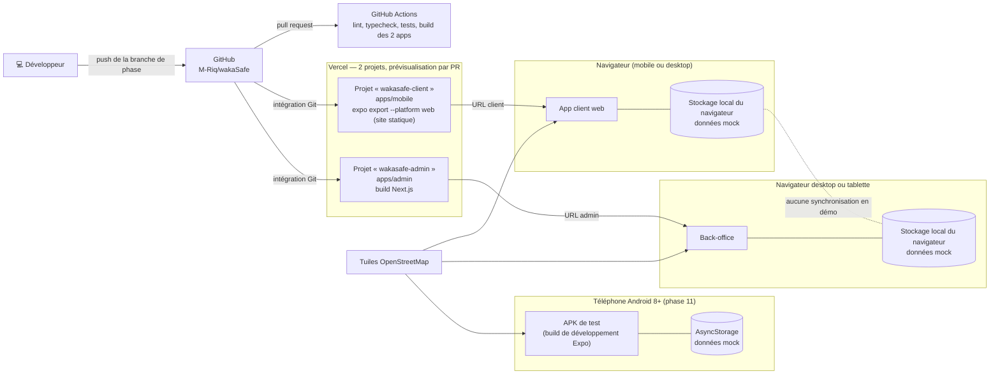
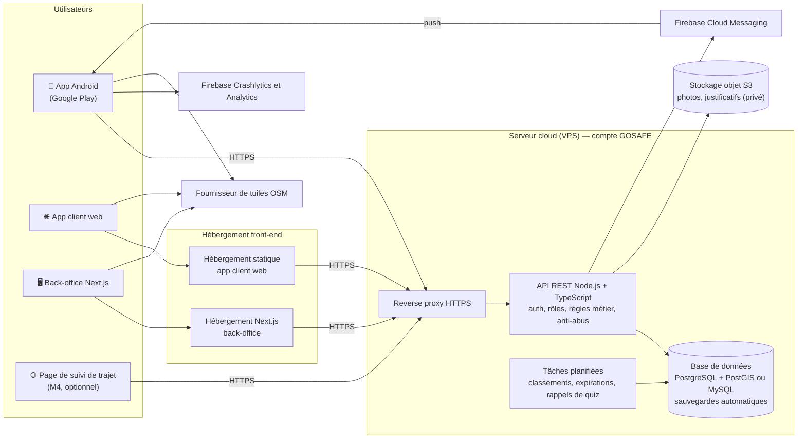

# 9. Diagramme de déploiement

> Source de vérité de ces diagrammes. Toute modification doit être reportée dans le [README](../../README.md).
> Décision associée : [ADR-0008](../adr/0008-demo-hosting-vercel.md).

## 9.1 Démo actuelle (phases 1 à 11) : deux front-ends statiques, données mock locales

## 9.2 Cible finale (phase 12 et suivantes)

Points ouverts pour la cible : l'hébergeur du VPS, le fournisseur de tuiles (la politique d'usage de `tile.openstreetmap.org` interdit un usage intensif en production) et l'option Supabase, qui remplacerait l'API, la base et le stockage. Tous les comptes sont créés au nom de GOSAFE.
